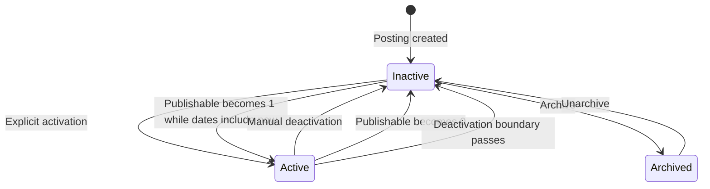

# Study Lifecycle

## Derived active status

There is no independent persisted active Boolean.

Matching-active membership is defined by `V_ACTIVE_STUDY`:

- `PUBLISHABLE = 1`
- Current calendar date on or after `POSTING_ACTIVATION_DATE`
- Current calendar date before `POSTING_DEACTIVATION_DATE`

The view truncates time-of-day. Its activation date is inclusive and its deactivation date is
exclusive.

`V_STUDY_STATUS` instead uses inclusive `BETWEEN`, so it may report `ACTIVE` on the deactivation date
when matching has already excluded the study. Pages must identify the governing view when that
difference matters.

## Initial and explicit activation

Initial activation requires study-team action.

Any associated study team member may activate the study when:

- `PUBLISHABLE = 1`
- The study is not archived
- Required posting content is complete
- A future deactivation boundary is supplied

Activation:

- Sends the browser's current epoch-millisecond time as the posting activation value
- Sends the selected calendar date's browser `Date.getTime()` value as the posting deactivation
  boundary
- Causes the derived state to become active
- Adds or updates the study in active in-memory matching data
- Creates or updates the applicable active interval
- Initiates asynchronous lifecycle-notification handling
- Initiates applicable match recomputation

The date picker is date-only but submits a JavaScript `Date` epoch value. It ordinarily represents
local midnight in the browser's effective time zone. The backend stores a timestamp without a zone,
while active calculations compare calendar dates. Reports that depend on exact boundaries must
account for the effective browser, application/JVM, and database time zones rather than assuming one
universal midnight.

A study team member cannot activate the study or assign a new activation range while
`PUBLISHABLE = 0`.

## Manual deactivation

Any associated study member may select Deactivate Study.

Manual deactivation:

- Sends browser `Date.now()` as the posting deactivation value, preserving click time rather than a
  date-picker midnight
- Makes the study inactive as current time moves beyond that boundary
- Prompts for the total number of participants enrolled through the application
- Removes the study from active in-memory matching data
- Updates the current active interval's deactivation and update times
- Initiates asynchronous lifecycle-notification handling

The enrollment field permits a nonnegative value, including an intentional zero, and the interface
also offers `I do not know`. The intended stored convention is:

- `0` = the study team reports that no participants were enrolled;
- positive value = the reported total; and
- `-1` = unknown or not entered.

The current client maps `doNotKnow || !enrollmentNumber` to `-1`. Preservation of an entered zero
therefore depends on the form binder supplying string `"0"` rather than numeric `0`; this runtime
edge case should be tested before treating every stored `-1` as an explicit `I do not know` choice.

Posting-date patch and enrollment-property merge are separate requests. They are not one atomic
transaction. A failure can therefore leave deactivation saved without the intended enrollment value,
or leave a prior enrollment value unchanged.

There is no separate manual-deactivation Boolean.

## Date-based expiration

Effective matching membership is derived from `V_ACTIVE_STUDY`. The view uses calendar dates and
requires:

- Current date on or after the posting activation date
- Current date before the posting deactivation date
- `PUBLISHABLE = 1`

When the deactivation date is reached, the study disappears from `V_ACTIVE_STUDY`. The scheduled
`activeStudiesSynchronizationJob` then removes it from each process-local active-study store and
starts asynchronous system-recommendation cleanup.

Pure passage of time does not call `StudyActiveIntervalService.updateInterval(...)` in the reviewed
code. It therefore does not itself create or close a `STUDY_ACTIVE_INTERVAL` row.

After the deactivation boundary has passed, publishability returning to `1` cannot reactivate the
study unless a study member establishes a new activation range.

## Upcoming-deactivation warning

The daily batch-notification job checks configured future calendar-day offsets
for studies approaching their deactivation dates. The offsets come from
`STUDY_ANNOUNCEMENTS_DAYS_AHEAD`; the installation seed is `2,14`, representing
two and fourteen calendar days ahead rather than a hard-coded one-week warning.

The warning uses the current Other Announcements recipient set and is separate
from the notification generated after the study becomes inactive. Calendar
boundaries use the application or Java virtual machine system-default time
zone.

No warning history or deduplication state is stored. Changing the deactivation
date can therefore cause a later warning when the revised date enters another
configured target day.

## Governance-driven inactivation

When `PUBLISHABLE` changes to `0`:

- The derived study state becomes inactive
- Recruitment stops
- Matching stops
- The study is removed from active in-memory matching data
- Participant information is hidden
- Existing conversations are hidden
- New exports are blocked
- Existing activation boundaries remain unchanged
- The current active interval closes
- Delayed lifecycle-notification handling begins

## Automatic reactivation

In the reviewed Java CSV path, when imported `PUBLISHABLE` changes and the resulting study is active
under its existing posting dates, reconciliation resets `STUDY.POSTING_ACTIVATION_DATE` to the current
application time and retains the configured posting deactivation date.

It then updates the operational study, updates interval history, refreshes process-local active-study
state, and initiates applicable matching. If the retained deactivation date has passed, the study
cannot remain active and a study member must establish a valid future range.

This is implementation-specific behavior, not a general business rule that publishability must reset
the posting activation date. The checked-in U-M Oracle job invokes database packages whose equivalent
implementation was not found in the reviewed source.

## Active intervals

`STUDY_ACTIVE_INTERVAL` stores configured active ranges used for lifecycle queries and notifications.
A row stores study ID, activation date, deactivation date, and update date. It has no direct cause,
actor, source, event type, or foreign key to another audit event. The service can add an interval or
mutate the most recent interval's deactivation and update times, so this table is not an immutable
event ledger.

Cause, actor, source, and event type can often be derived by temporal and entity correlation:

- A nearby `STUDY_AUDIT` row containing `postingDeactivationDate` supports study-team deactivation
  and identifies the application user. A row containing both posting-date paths supports explicit
  activation.
- In the reviewed Java CSV path, a nearby `IMPORTED_STUDY_SYNC_LOG` row for `STUDY.PUBLISHABLE`
  with old and new values supports an imported governance transition.
- Reaching the configured boundary without a corresponding posting-date audit or publishability sync
  can support scheduled expiration as a reporting classification.

These are evidence-supported classifications rather than stored interval causes. Closely timed
actions, missing or expired audit data, direct database changes, and deployment paths without
equivalent logs can remain ambiguous and must be reported as unknown. `STUDY_AUDIT` identifies user,
study, operation time, and changed paths, but does not retain old and new values. The Java sync log
records old and new publishability values but no actor, upload/run ID, source filename, or resulting
interval ID.

The interval service is called by two confirmed production paths:

- Direct study updates that change posting activation or deactivation dates
- Imported publishability transitions

Its behavior is:

- First activation creates an interval.
- Reactivation after a prior interval creates another interval.
- Changing the current interval end updates the most recent interval.
- Imported transition to active sets activation to the current time and records the resulting range.
- Imported transition from active to inactive closes the current range at the current time.

No scheduled job mutates intervals merely because time crosses a posting boundary. Interval rows
therefore represent ranges recorded when application or import code changes lifecycle-driving data;
they are not a complete event log proving when each application server observed a date-driven
transition.

## Lifecycle notifications

Lifecycle email is asynchronous.

The daily batch-notification job evaluates activation and deactivation changes
recorded in `STUDY_ACTIVE_INTERVAL` during the previous calendar day. It queries
from the previous day at midnight through one second before the current day at
midnight, using the application or Java virtual machine system-default time
zone.

The interval-query rules exclude superseded transitions. A sequence such as:

```text
ACTIVE → INACTIVE → ACTIVE within the queried period
```

may therefore produce no deactivation announcement even though operational
changes and interval updates occurred. CSV rows are reconciled in file order, so
the inactive and active transitions each invoke interval handling when their
effective status changes. Database work may still share one import-batch
transaction, while process-local memory updates and asynchronous matching
submission occur during each row before that transaction commits. This is
query-based event stabilization, not a separate PI-only recipient rule or a
rolling 24-hour delay.

For each selected lifecycle event, the application resolves the complete
current Other Announcements recipient set at dispatch time. This may include
the current PI, other selected accepted study team members, and external
addresses. The query does not distinguish manual, date-driven, and
publishability-driven causes.

The same daily job evaluates upcoming-deactivation warnings using configured
future calendar-day offsets. The installation seed is two and fourteen days
ahead. Warning delivery has no persisted sent state or deduplication marker.

## Effects of date-based inactivity

When a study is inactive by date but remains publishable:

- It is not publicly discoverable
- Its valid direct URL displays a not-currently-recruiting message
- It is removed from active matching
- It is removed from active in-memory matching data
- New Ask if interested actions are blocked
- New expressions of interest are blocked
- Historical interested-participant data remains available for active participants
- Existing conversations remain visible
- New exports of otherwise visible historical interested-participant data remain permitted

The application does not retain a server-side historical export file.

## Questionnaire editing

A screening questionnaire may be edited only while the study is inactive.

See [Questionnaires and Exports](../06-recruitment/questionnaires-and-exports.md).

## Archive status

Archive status is independent of active status.

Only an inactive study may be archived.

See [Study Archiving](study-archiving.md).

## Lifecycle diagram



## Active-view date semantics

The database view used to populate active matching studies compares calendar
dates rather than exact timestamps.

In `V_ACTIVE_STUDY`:

- Activation date is inclusive.
- Deactivation date is exclusive.
- Time-of-day is ignored.
- `PUBLISHABLE` must be `1`.

Date-driven membership changes reach each process-local active-study store
through scheduled active-study synchronization. A direct study update may
update the local store and trigger matching or cleanup immediately.

## Status-view inconsistency

`V_STUDY_STATUS` uses an inclusive `BETWEEN` comparison, while
`V_ACTIVE_STUDY` excludes the deactivation date.

On the saved deactivation date, these views may disagree about whether a study
is active. Until this inconsistency is resolved, documentation must identify
which view governs the workflow being described.

Matching uses active entities loaded from `V_ACTIVE_STUDY`.

## Active-interval updates

The complete production call-site search for
`StudyActiveIntervalService.updateInterval(...)` finds only:

- `StudyServiceImpl`
- `StudyImportSynchronizerImpl`

The seeded schedule row named `updateActiveIntervalsJob` has no corresponding dynamic-job bean in the
reviewed Java source. Because application jobs are discovered from Spring beans implementing
`DynamicallyReschedulableJob`, the schedule row alone is not executable.

`BatchNotificationJob` queries existing interval rows to identify activation and deactivation
announcements. It does not update interval rows.

### Confirmed date-view inconsistency

`V_ACTIVE_STUDY` excludes the posting deactivation date, while `V_STUDY_STATUS` uses an inclusive
`BETWEEN` comparison. On the saved deactivation date, the two views may disagree.

Matching membership follows `V_ACTIVE_STUDY`. Choosing which view should be corrected remains a
product and technical decision.

## Related pages

- [Publishability](../03-institutional-governance/publishability.md)
- [Study Archiving](study-archiving.md)
- [Study Notifications](study-notifications.md)
- [Public Study Discovery](../06-recruitment/public-study-discovery.md)
- [Matching and Visibility](../06-recruitment/matching-and-visibility.md)
